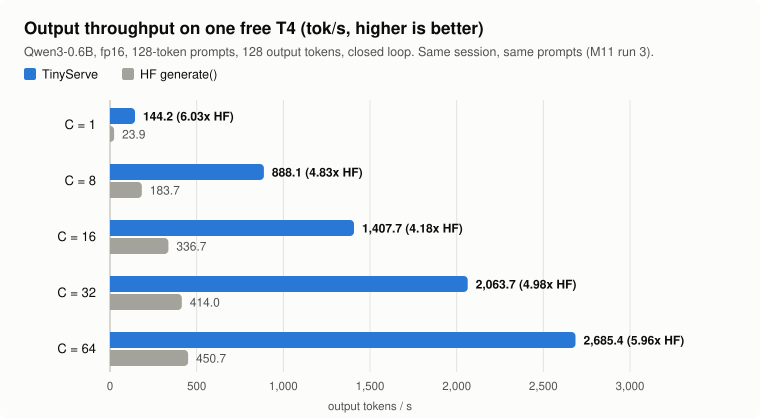
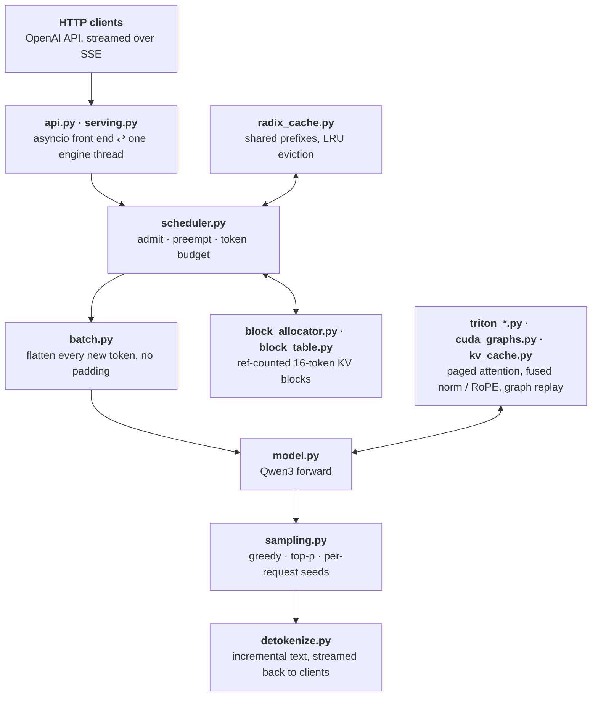

<div align="center">

# TinyServe

**A from-scratch LLM inference engine for one free NVIDIA T4.**

Paged KV cache · continuous batching · radix prefix cache · custom Triton attention kernels · CUDA graphs · OpenAI-compatible streaming API

[](https://github.com/princemittalr/tinyserve/actions/workflows/ci.yml)


[Results](#results) · [Quickstart](#quickstart) · [How it works](#how-it-works) · [What I learned](#what-the-measurements-taught-me) · [Testing](#how-its-tested) · [Limitations](#limitations) · [Write-up](docs/WRITEUP.md) · [Lab notebook](PROGRESS.md)

</div>

---

TinyServe serves [Qwen3-0.6B](https://huggingface.co/Qwen/Qwen3-0.6B) on a 16 GB Turing GPU, the kind Kaggle and Colab give away for free. It is about 5,300 lines of Python and Triton, built in twelve milestones (M0–M11), each one measured on a real T4 before the next began.

- **5.0x the throughput of Hugging Face `generate()`** at 32 concurrent sequences (2,064 vs 414 tok/s), and 6.0x for a single sequence (144 vs 24 tok/s), same session, same prompts.
- **Token-identical to Hugging Face in fp32:** 0 mismatches over 1,920 greedy tokens, batched, with the default GPU setup (every kernel and CUDA graphs on).
- **Its own Triton kernels:** paged decode attention (per head, GQA-grouped, split-K), varlen prefill attention, and fused RMSNorm / q-k norm + RoPE + KV-write.
- **Honest numbers:** every figure below comes from a logged run with its date, hardware and script in [PROGRESS.md](PROGRESS.md). Anything not measured is labelled *inferred*.

It is written to be read and understood, not to compete with vLLM. It does not do tensor parallelism, quantization or multi-model serving.

## Results

<p align="center">
  
</p>

Kaggle Tesla T4, fp16, Qwen3-0.6B. The workload: seeded random 128-token prompts, 128 greedy output tokens each, EOS ignored, closed loop at concurrency C (HF runs static batches of C). TinyServe and HF ran in the same session on the same prompts (2026-10-19, M11 run 3).

| Concurrency | TinyServe engine | TinyServe over HTTP | HF `generate()` | TinyServe / HF |
|---:|---:|---:|---:|---:|
| 1 | 144.2 | 139.5 | 23.9 | **6.03x** |
| 8 | 888.1 | 825.6 | 183.7 | **4.83x** |
| 16 | 1,407.7 | — | 336.7 | **4.18x** |
| 32 | 2,063.7 | 1,914.5 | 414.0 | **4.98x** |
| 64 | 2,685.4 | 2,379.5 | 450.7 | **5.96x** |

<sub>Output tokens per second. HTTP: streaming `/v1/completions`, client on the same machine. TPOT p50 at C=32: 14.2 ms.</sub>

**Correctness.** In fp32, greedy output matches HF `generate()` exactly: 0 mismatches over 120 prompts × 16 tokens, run batched at batch 32 and at batch 8 with every kernel and CUDA graphs on. Greedy text served over HTTP is identical to HF's too (checked with the default setup in M9). In fp16, 5 of the 120 prompts diverge, every one at a near-tie where HF's top two logits differ by at most 0.0625, so the flips are fp16 rounding rather than kernel bugs.

**Against vLLM.** In an M10 session, vLLM 0.32 with CUDA graphs ran 135.5 tok/s at C=1 and TinyServe 140.6. That is the only same-session comparison. Earlier vLLM runs at higher concurrency came from a different session and torch version, so [the write-up](docs/WRITEUP.md#4-comparison-with-hf-generate-and-vllm) keeps them with their caveats rather than quoting them here as a headline.

### How it got there

Throughput at C=32 after each milestone. These rows come from different Kaggle sessions, and the same code varied up to ~6% between sessions, so from M8 on each change was also measured against the code before it in one session ([PROGRESS.md](PROGRESS.md#benchmark-results)).

| Milestone | What changed | tok/s at C=32 |
|---|---|---:|
| M3 | Continuous batching, attention in PyTorch one sequence at a time | 88.0 |
| M4 | Triton paged decode-attention kernel: one launch per layer for the whole batch | 716.0 |
| M8 | CUDA graphs, batched prefill, GQA-grouped decode kernel | 1,343.8 |
| M9 | Split-K decode, fused norm / RoPE / KV-write kernels | 1,580.3 |
| M10 | Merged q/k/v and gate/up weights, padded output head, compile-once kernels | 1,603.9 |
| M11 | Decode kernels at 1 warp per program instead of 4 | **2,063.7** |
| | HF `generate()`, for reference | 414.0 |

## Quickstart

TinyServe needs Python 3.11+ and PyTorch 2.9+. Triton (bundled with PyTorch on Linux) enables the GPU kernels; without it, or on a CPU, the plain PyTorch reference paths run instead.

```bash
git clone https://github.com/princemittalr/tinyserve.git && cd tinyserve
python -m venv .venv && source .venv/bin/activate   # Windows: .\.venv\Scripts\Activate.ps1
pip install -e ".[dev]"

python scripts/inspect_weights.py     # downloads Qwen3-0.6B (~1.5 GB) to checkpoints/ and loads it strictly
```

**Generate** with TinyServe's own forward pass:

```bash
python scripts/generate.py --prompt "The capital of France is" --max-new-tokens 20
```

**Serve** an OpenAI-compatible API (binds to 127.0.0.1:8000):

```bash
python scripts/serve.py
```

```bash
curl http://127.0.0.1:8000/v1/chat/completions -H "Content-Type: application/json" \
  -d '{"messages": [{"role": "user", "content": "Hi"}], "stream": true, "temperature": 0}'
```

Any OpenAI client works:

```python
from openai import OpenAI

client = OpenAI(base_url="http://127.0.0.1:8000/v1", api_key="unused")
stream = client.chat.completions.create(
    model="Qwen3-0.6B",
    messages=[{"role": "user", "content": "Explain paged attention in one sentence."}],
    stream=True,
)
for chunk in stream:
    print(chunk.choices[0].delta.content or "", end="", flush=True)
```

<details>
<summary><b>Server options</b></summary>

On a GPU with Triton the server picks the fastest setup measured on the T4: split-K decode attention, batched prefill, fused kernels and CUDA graphs (captured before it starts listening, which takes a few seconds and ~220 MiB). On a CPU it uses the PyTorch reference paths.

| Flag | Effect |
|---|---|
| `--attention`, `--prefill-attention` | Pick the decode and prefill attention implementation |
| `--no-cuda-graphs`, `--no-fused-kernels` | Turn off graphs or fused kernels |
| `--prefix-cache` | Reuse KV blocks across requests that share a prompt prefix (opt-in) |
| `--chunked-prefill` | Split long prompts across steps under `--max-batch-tokens` (opt-in) |
| `--kv-gib`, `--block-size`, `--max-num-seqs` | KV-cache size, tokens per block, batch limit |
| `--allow-remote` | Required to bind to anything but loopback; there is no authentication |

Endpoints: `/v1/completions` and `/v1/chat/completions` (both with `"stream": true`), `/v1/models`, `/health`. Supported: `temperature`, `top_p`, `seed`, `stop` (up to 4 strings), `n` (up to 8; with a seed, choice *i* uses seed + *i*) and logprobs, in OpenAI's formats. Oversized bodies, prompts, `max_tokens` and too many requests in flight get 413 / 400 / 429. Unsupported options such as `echo` or penalties get a 400 instead of being silently ignored.

</details>

<details>
<summary><b>Running on a free Kaggle or Colab T4</b></summary>

```python
%cd /kaggle/working
!git clone -q https://github.com/princemittalr/tinyserve.git
%cd /kaggle/working/tinyserve
!pip install -q --no-deps -e . && pip install -q hypothesis fastapi uvicorn httpx
!python scripts/inspect_weights.py

# The headline benchmark (default GPU setup) and the HF baseline on the same prompts
!python scripts/benchmark.py --device cuda --cuda-graphs --attention triton_split --prefill-attention batched --fused-kernels --concurrency 1,8,16,32,64
!python scripts/bench_hf.py --device cuda --concurrency 1,8,16,32,64

# fp32 greedy parity against HF generate(), batched
!python scripts/compare_hf.py --engine batched --device cuda --dtype float32 --cuda-graphs --attention triton_split --prefill-attention batched --fused-kernels
```

Every milestone's exact commands are in [docs/WRITEUP.md § How to reproduce](docs/WRITEUP.md#how-to-reproduce).

</details>

## How it works



`engine.py` runs the middle of this chain once per step, for as long as there is work. Every step, the **scheduler** re-plans the batch (continuous batching, as in Orca): finished sequences leave, waiting ones join if there are free KV blocks and token budget, and when the cache is full the newest running sequence is preempted and later recomputed, so the oldest always makes progress. The **batch** flattens every sequence's new tokens into one `[T]` tensor with no padding, so the linear layers run once for everyone. The **model** writes the new keys and values into the paged cache, then attends over each sequence's blocks through its block table.

### The pieces

| Component | File | Lines | Idea |
|---|---|---:|---|
| Paged KV cache | `kv_cache.py`, `block_table.py`, `block_allocator.py` | 260 | KV memory in fixed 16-token blocks, as in vLLM's PagedAttention. A sequence's block table maps position *p* to slot `blocks[p // 16] * 16 + p % 16`. Blocks are reference-counted so sequences and the prefix cache can share them. |
| Scheduler | `scheduler.py`, `sequence.py` | 347 | FCFS admission under a sequence limit, a token budget and free blocks; preemption by recompute; optional chunked prefill. |
| Radix prefix cache | `radix_cache.py` | 196 | A radix tree over token blocks, as in SGLang's RadixAttention. A new request adopts the longest cached whole-block prefix; unused leaves are evicted LRU before anyone is preempted. |
| Decode attention | `triton_attention.py` | 586 | Three Triton kernels: one program per (sequence, query head); one per KV head that shares each k/v load across the GQA group; and a split-K variant that cuts long contexts into up to 16 ranges for small batches and merges the partial softmaxes. All read the block table in place with an online softmax. |
| Prefill attention | `triton_prefill.py`, `attention.py` | 436 | A varlen Triton prefill kernel over cache blocks, and batched SDPA (the T4 default, see below). |
| Fused kernels | `triton_fused.py` | 177 | RMSNorm, and q/k head norm + RoPE + KV-cache write in one kernel, matching the PyTorch path's rounding step by step. |
| CUDA graphs | `cuda_graphs.py` | 173 | One captured decode step per batch-size bucket (1, 2, 4, 8, then multiples of 8); padding rows write to a block nobody owns. |
| Model | `model.py`, `layers.py`, `weights.py`, `config.py` | 741 | Qwen3 from safetensors with a strict loader. No `transformers` at runtime; HF is used only as a test reference. |
| Sampling | `sampling.py` | 128 | Batched temperature / top-p via the exponential race (argmax of *p / E*, *E* ~ Exp(1)); a seeded request gives the same tokens whatever batch it lands in. |
| Serving | `serving.py`, `api.py`, `server.py`, `detokenize.py` | 1,057 | One engine thread, many asyncio clients. Disconnected clients are aborted and their blocks freed. Text is detokenized incrementally without splitting UTF-8 characters. |
| Measurement | `bench.py`, `profiling.py`, `roofline.py` | 552 | Closed-loop benchmark (tok/s, TTFT, TPOT p50/p99), a per-step trace, and a roofline model checked against the real checkpoint's 596,049,920 parameters. |

## What the measurements taught me

The full analysis, with profiles and tables, is in [docs/WRITEUP.md](docs/WRITEUP.md). The short version:

1. **Decode is memory-bound, but the first bottleneck was Python.** A decode step reads all 1.19 GB of weights plus the KV cache, at an arithmetic intensity far below the T4's ridge point, so bytes set the floor. In M7, though, a C=32 forward pass took 34 ms against a 5.9 ms floor, and the GPU was idle about half of it, waiting for Python to issue the next of 1,851 kernel launches. CUDA graphs alone gave +50% at C=32.
2. **Measure the ceiling instead of trusting the spec.** The T4's datasheet says 320 GB/s, but a plain 512 MiB read reaches 275 GB/s (a copy, 233–235). At 275 GB/s the C=32 floor is 6.9 ms, and TinyServe's step is 12.5 ms: the GEMMs take 6.8 ms (cuBLAS, 174 GB/s) and the decode kernel 2.4 ms (212 GB/s).
3. **Fewer warps beat wider tiles.** Loading several KV blocks per loop iteration was slower at every batch above 1. Dropping from 4 warps per program to 1 made the decode kernel 2.0–2.45x faster on its own and gave +27.6% end to end at C=32. *Inferred* from register counts, since Kaggle blocks GPU counters: at 1 warp, 15 programs fit per SM instead of 6, so C=32's 256 programs run in one wave instead of two.
4. **Triton compiles one variant per argument value class.** A per-step value (the block-table width, the split count) reaching a kernel as a specialized argument made Triton compile mid-run, stalling one step for 1,425 ms. Each kernel now compiles once per dtype, and a CPU test fails if a kernel specializes on a per-step value.
5. **No tensor cores for Triton before sm_80.** On the T4, `tl.dot` becomes FMA loops with tiles in registers. The Triton prefill kernel is 15% faster than batched SDPA on prefix-cache hits but 25% slower on fresh 512-token prompts, so SDPA stays the default. Compiled for sm_80, the same kernel emits 48 tensor-core `mma` instructions, but no free GPU can run it.
6. **The slow-TTFT tail was not the GIL.** HTTP TTFT p99 was seconds while the event loop was never more than 11 ms late. The slow requests were random-token outputs that decode to empty text, so their first visible chunk arrived only with their last token. Measured to the first token, p99 at C=32 is 416 ms (M10).

## How it's tested

**598 tests pass on the T4** (2 skipped: the real-checkpoint tests). On every push, GitHub Actions runs the suite on CPU for Python 3.11, 3.12, 3.13 and 3.14, with ruff and strict mypy; Triton kernels run there in Triton's CPU interpreter. Highlights:

- **Parity with Hugging Face.** A tiny random Qwen3 built with `transformers` is loaded through TinyServe's own loader in CI, and its logits and greedy tokens must match. `scripts/compare_hf.py` runs the same check on the real model over 120 prompts.
- **Property tests (Hypothesis).** The block allocator never hands out a block twice and never leaks; reference counts always equal owners; every radix-cache match returns blocks computed for exactly that prefix; the scheduler finishes every request without livelock; chunked prefill stays within budget.
- **Kernels against references.** Every Triton kernel is compared with a PyTorch reference across head groupings, block sizes, lengths, tiles and split counts. Cache slots no sequence owns hold NaN, so any out-of-range read fails.
- **Compile checks for the T4 without a T4.** `tests/test_t4_compile.py` compiles every kernel for sm_75 and fails on register spills over 1 KiB, which the interpreter cannot see.
- **Device bugs on a laptop.** The model also runs on PyTorch's `meta` device, so a tensor created without `device=` fails on CPU instead of on the GPU.
- **CUDA graphs.** On the GPU, a graph replay equals the eager pass bit for bit, and the step runs under `torch.cuda.set_sync_debug_mode("error")`.
- **End to end.** The real server process is started on a tiny checkpoint and must stream the same text as the offline engine. Disconnecting clients free every block.

```bash
ruff check . && ruff format --check . && mypy && pytest     # GPU tests (@pytest.mark.gpu) skip without CUDA
```

## Limitations

- **One GPU, one model family.** No tensor parallelism and no quantization. Only dense Qwen3 checkpoints load; anything else is rejected at load time.
- **Tuned for the T4 only.** Warps, split counts and default paths were chosen from T4 measurements. Weights load in fp16, because the T4 has no fast bf16.
- **One benchmark workload.** Random-token prompts, fixed lengths, EOS ignored, on one GPU type. Real traffic and other GPUs may behave differently.
- **Not production-ready.** The API has no authentication (it binds to 127.0.0.1 by default) and no `echo`, top-k or penalties. Requests without a seed are reproducible per run, not per request.
- **The prefix cache reuses whole 16-token blocks only.** It is opt-in, and so is chunked prefill, which lowers median TTFT but costs 1–3% throughput and raises TTFT p99.
- **CUDA graphs cover pure decode steps only.** Prefill and mixed steps run eagerly.
- **Triton has no Windows wheels.** On Windows the kernel tests skip and the PyTorch paths run.
- **Questions free hardware cannot answer:** why the fused kernels slowed the 4-warp decode kernel by ~1 ms inside a step (M10), and the mechanism behind the 1-warp speed-up, need GPU performance counters, which Kaggle blocks. The Triton prefill kernel on sm_80+ is compile-checked only.

## Repository layout

```
src/tinyserve/      the engine: model, cache, scheduler, kernels, server (~5,300 lines)
tests/              37 test modules: unit, property, parity, kernel, compile and end-to-end tests
scripts/            serve, generate, benchmark, profile and HF / vLLM comparison scripts
benchmarks/prompts/ the 120 parity prompts and the shared-prefix chat prompts
results/            raw JSON from the runs through M8 (later runs are transcribed in PROGRESS.md)
docs/WRITEUP.md     roofline, where the time goes, comparison with vLLM, how to reproduce
PROGRESS.md         milestone log, design decisions and every benchmark with date and hardware
```

## Prior art and acknowledgements

TinyServe re-implements ideas from these projects at a size one person can read:

- **vLLM** — PagedAttention (Kwon et al., SOSP 2023), the paged KV cache and block tables.
- **SGLang** — RadixAttention, the radix-tree prefix cache.
- **Orca** (Yu et al., OSDI 2022) — iteration-level scheduling, i.e. continuous batching.
- **nano-vllm** and **Mini-SGLang** — proof that a readable serving engine can be small.
- **FlashAttention** and **FlashDecoding** — the online softmax and split-K decoding.

What TinyServe adds is a T4-first focus: its own Triton kernels tuned for Turing, and a benchmark suite where every number can be traced to a logged run.

TinyServe was built step by step with an AI mentor. [PROGRESS.md](PROGRESS.md) records, step by step, which parts the mentor wrote and which I filled in.

## License

[MIT](LICENSE).
